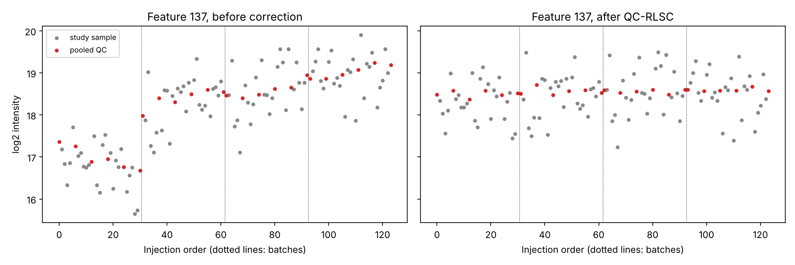
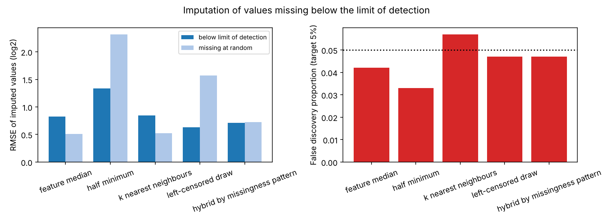

# Drift correction and missing-value imputation in untargeted metabolomics

Two preprocessing choices shape almost every untargeted LC-MS metabolomics result: how to remove signal drift across a long injection sequence, and how to fill values the instrument did not detect. This project benchmarks both on simulated studies where the true abundances are known, so each method is judged on what it recovers rather than on how the data look afterwards.

A companion analysis of real data, the urinary metabolome across age, BMI, and sex, is in [urine-metabolomics-age-bmi-sex](https://github.com/pkamand1/urine-metabolomics-age-bmi-sex).

## Simulation

Each of 20 simulated studies has:
- 400 features and 100 study samples (50 cases, 50 controls), run in 4 analytical batches.
- A pooled QC sample injected at the start of each batch and after every 5 study samples.
- Features with a true biological abundance; 40 of them differ between groups by ±0.6 log2 units (about 1.5-fold).
- A per-batch offset and a smooth within-batch drift for every feature, plus measurement noise.
- Values below a feature-specific limit of detection reported as missing (missing not at random), mostly in low-abundance features, plus 2% of values missing completely at random. In all, 4.6% of values are missing, 58% of them below the detection limit.

## Results

### Drift correction



| Correction | Median QC SD (log2) | Features with QC CV < 20% | Median correlation with true abundance | False discovery proportion | Power |
| --- | --- | --- | --- | --- | --- |
| None | 0.382 | 21% | 0.79 | 4.9% | 89.0% |
| Per-batch median centering | 0.208 | 92% | 0.93 | 5.3% | 97.1% |
| QC-RLSC (QC-based LOESS within batch, then batch alignment) | 0.080 | 100% | 0.96 | 4.2% | 98.6% |

QC-RLSC fits each feature's drift on the pooled QC injections within each batch, removes it from the study samples, and aligns batches on the QC median. It cuts QC variability by nearly 80% and brings every feature under the common 20% CV acceptance threshold. Median centering removes batch offsets but not the drift within a batch. False discoveries stay near 5% even without correction here, because cases and controls were randomized across the run order, so drift adds noise rather than bias. Correction then recovers power. Had the run order been confounded with group, uncorrected drift would have produced false discoveries.

### Imputation (after QC-RLSC)



| Imputation | RMSE, below detection limit | Bias, below detection limit | RMSE, missing at random | Bias, missing at random | FDP | Power |
| --- | --- | --- | --- | --- | --- | --- |
| Feature median | 0.83 | +0.73 | 0.51 | −0.01 | 4.2% | 98.4% |
| Half minimum | 1.34 | −1.27 | 2.32 | −2.25 | 3.3% | 95.0% |
| k nearest neighbours | 0.85 | +0.74 | 0.52 | 0.00 | 5.7% | 99.1% |
| Left-censored draw | 0.63 | −0.45 | 1.57 | −1.46 | 4.7% | 98.6% |
| Hybrid by missingness pattern | 0.71 | −0.27 | 0.73 | −0.20 | 4.7% | 99.5% |

The right imputation depends on why a value is missing. Values below the detection limit are low by definition. A median or nearest-neighbour fill places them well above where they belong, while a left-censored draw from below the feature's observed minimum gets closest. Values missing at random are typical values. For those the median and nearest neighbours are nearly unbiased, and the left-censored draw is badly wrong. The common half-minimum rule is the worst for both kinds and costs the most power.

A hybrid that treats features missing in many samples as censored and sporadic gaps as random balances the two. It has the smallest overall bias and the highest power, while keeping false discoveries at the nominal level. In real data the mechanism is not known, so the practical lesson is to look at the pattern of missingness (how often a feature is missing and whether missingness tracks low intensity) before choosing a method.

## Repository layout

```
src/benchmark.py           simulation, drift correction, imputation, evaluation, figures
tests/test_benchmark.py    checks on the correction and on the benchmark's conclusions
results/tables/            drift_correction.csv, imputation.csv (means over 20 studies)
results/figures/           drift example and imputation comparison
```

## How to run

```
pip install -r requirements.txt
python src/benchmark.py --studies 20
python -m pytest -q tests
```

The benchmark runs in about a minute.

## Author

Patricia K. Kamanda. Released under the MIT License.
